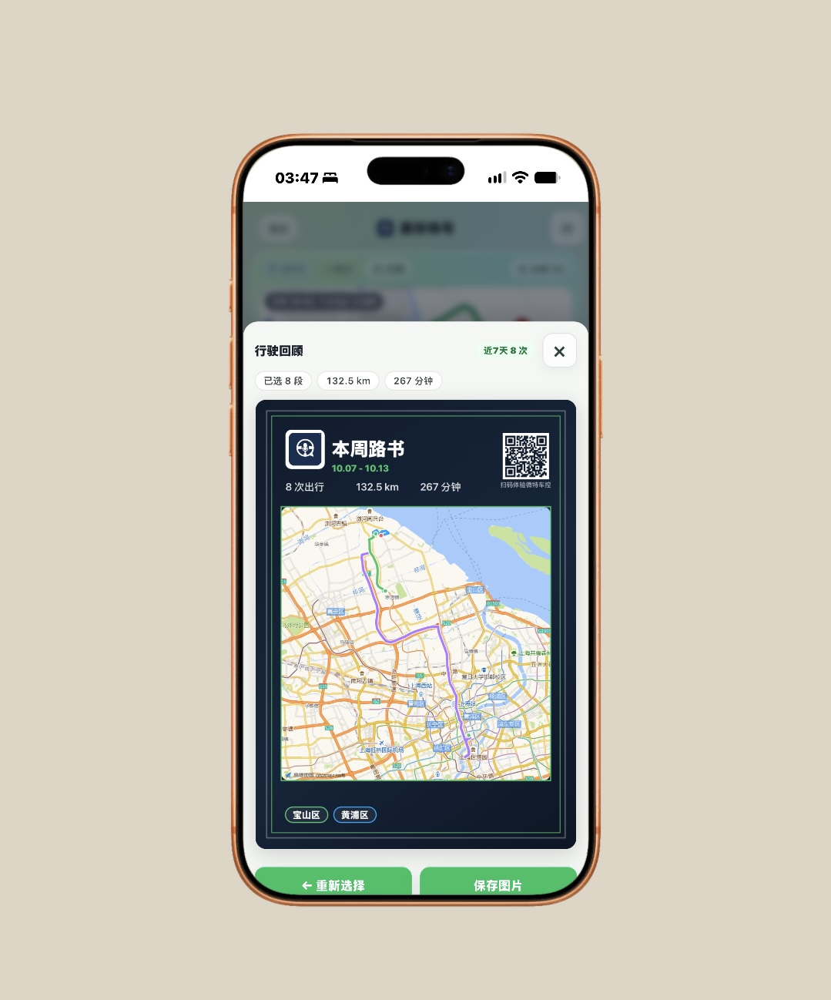
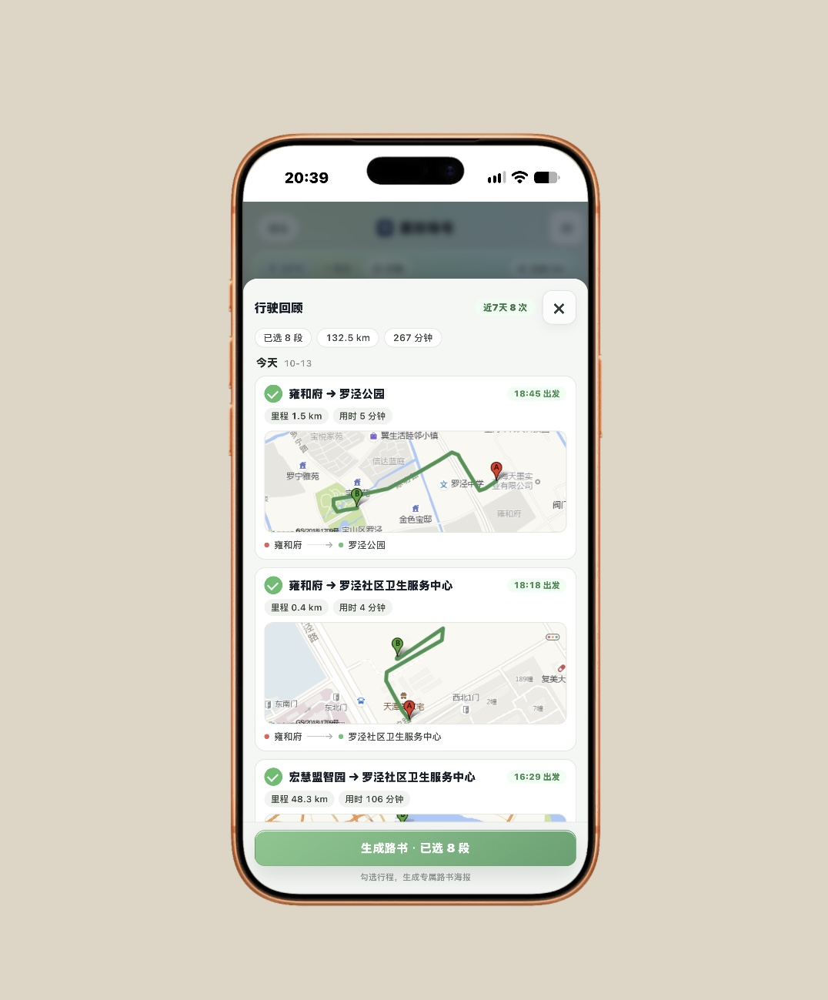
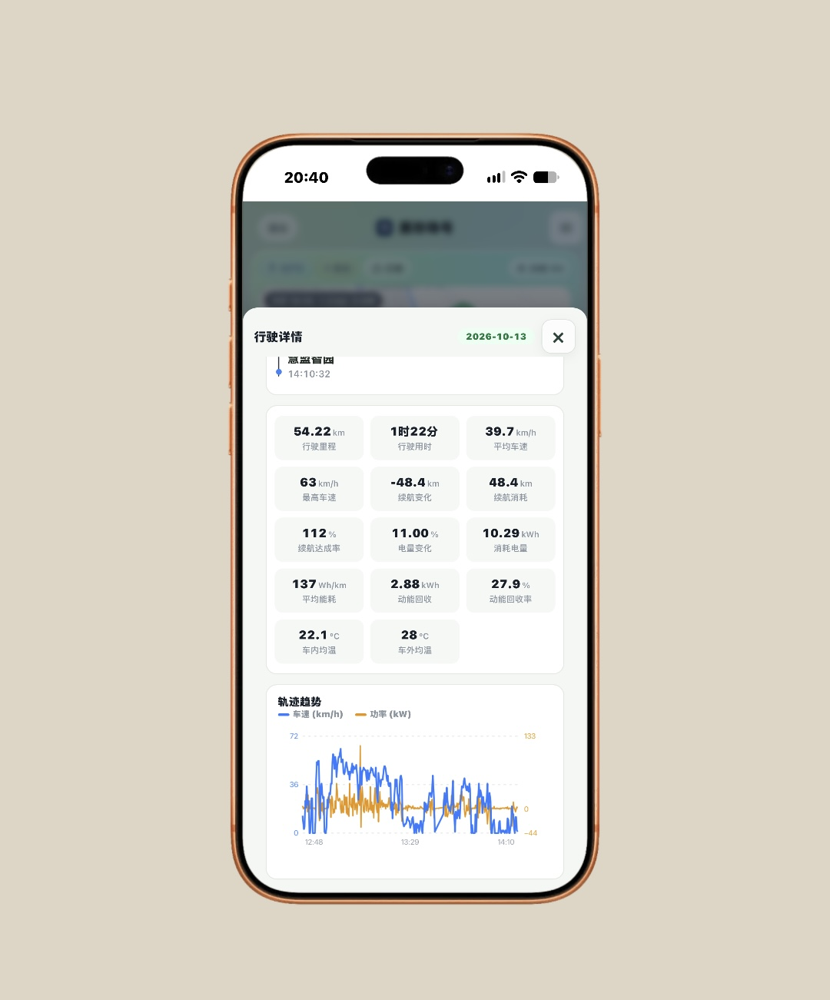
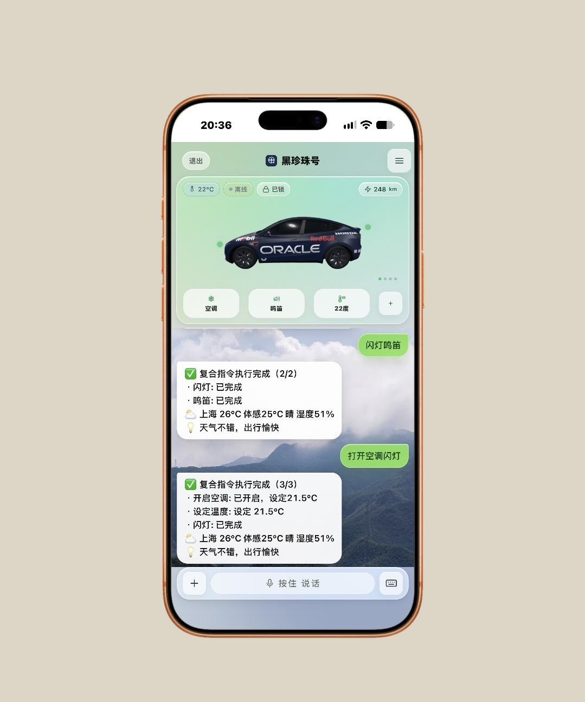
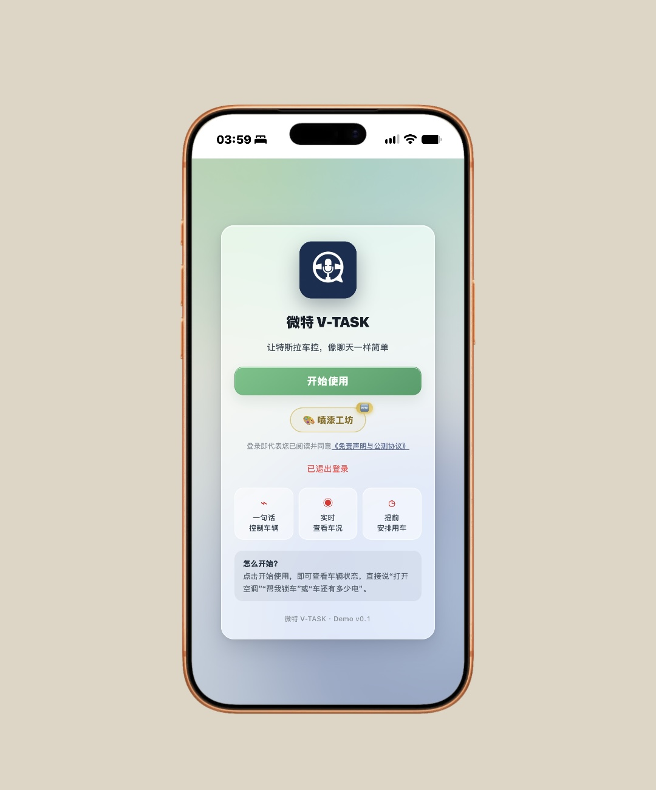

# V-TASK · 特斯拉多用户车控 Web 控制台

纯 Python 标准库实现的多用户特斯拉车控 Web 服务（零 pip 依赖）：
邮箱验证码登录、Tesla OAuth 车辆绑定、自然语言车控（闪灯/鸣笛/空调/充电/后备箱/哨兵…）、
SSE 实时车况、3D 车模仪表盘与贴膜工坊（WebGL）、行程地图、语音转写（可选）。

配套的微信小程序前端见 `vtask-tesla-miniapp` 仓库（接口契约一致）。

> 免责声明：本项目与 Tesla, Inc. 无关。Fleet API 凭据与用户令牌请妥善保管。

## 组件

| 文件 | 说明 |
|---|---|
| `car-web-multi.py` | 主 Web 服务（HTTP 8794）：登录/绑定/车控/车况/贴膜/行程 |
| `user_runner.py` | 指令执行器：意图解析（本地规则 + 可选 LLM）→ Tesla Fleet API |
| `run.py` | Fleet 基础库：令牌刷新、命令下发、智能温控、天气 |
| `car_schedule_multi.py` | 定时用车（出发前预热/提醒） |
| `email_auth.py` / `auth_http.py` | 邮箱验证码登录 + HTTP 鉴权基类（SQLite 身份库） |
| `identity_policy.py` / `intent_safety.py` | 身份与意图安全白名单 |
| `asr_postprocess.py` | 语音转写后处理（车控语境纠错，可选 ASR 用） |
| `static/` | Web 控制台前端（index.html + 3D 查看器 + 贴膜工坊） |
| `systemd/` | systemd 单元样例 |
| `test_voice_matrix.py` | 语音意图解析回归矩阵（48 条说法） |

依赖：Python 3.11+，**全部标准库**；可选组件（ASR、命令代理）见 [DEPLOY.md](DEPLOY.md)。

## 产品预览

| 仪表盘 · 语音控车 | 行驶回顾 | 行驶详情 |
|---|---|---|
|  |  |  |

| 本周路书海报 | 登录 |
|---|---|
|  |  |

<p align="right"><sub>截图为真机界面演示（车模贴膜为用户自定义皮肤）</sub></p>

## 快速开始

```bash
sudo mkdir -p /opt/tesla-fleet-multi && sudo chown $USER /opt/tesla-fleet-multi
git clone https://github.com/<你>/vtask-tesla-web.git /opt/tesla-fleet-multi
cd /opt/tesla-fleet-multi
python3 -X utf8 test_voice_matrix.py        # 48/48 即解析层正常
python3 -X utf8 car-web-multi.py            # 前台试跑，默认 127.0.0.1:8794
```

生产部署（systemd、Tesla 开发者凭据、域名/TLS、车模资源下载、ASR）见 **[DEPLOY.md](DEPLOY.md)**。

## 测试

```bash
OWNER_BASE=<你的 fleet 基础库目录> python3 -X utf8 test_voice_matrix.py
```

## License

[MIT](LICENSE)
